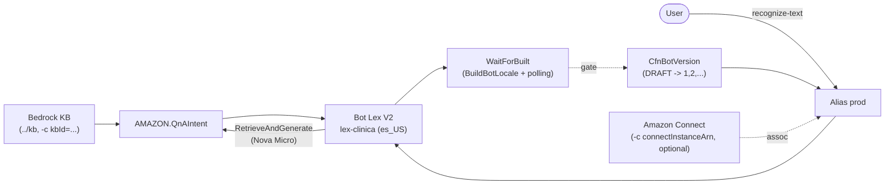

# Demo-Lex: Amazon Lex + Bedrock Knowledge Base

> *Medical conversational bot: intents, slots and QnAIntent over the Knowledge Base*

Bot demo project, which complements [`demo-kb`](https://github.com/kaesar/demo-kb) (and even [`demo-cx`](https://github.com/kaesar/demo-cx)). It applies what is done in the Amazon Lex console but **with CDK (TypeScript)**, that is:

- bot creation
- locale definition
- intents definition
- slots definition
- slot types definition
- connection of `AMAZON.QnAIntent` to the Bedrock Knowledge Base

> uses **CDK** to build (`Build`), publish (`version`) and expose via **alias**.  
> `AMAZON.QnAIntent` is the Bedrock-powered built-in intent for questions over the authorized Knowledge Base (via `RetrieveAndGenerate`).

```
  ______
./ lex /
├── cdk/bin/lex.ts              # Single App: LexStack (fixed region us-east-1)
├── cdk/lib/lex-stack.ts        # Bot + role + locale + intents + QnA + version + alias
├── cdk/lib/wait-built.ts       # Custom resource "Build" (BuildBotLocale + polling)
├── cdk/test/lex.test.ts        # Synth tests (no VPC, DESTROY, KB decoupling)
├── cdk/cdk.json                # App + feature flags (CLI runs from here)
├── srv/wait-built/index.ts     # Custom resource handler (lexv2-models)
├── scripts/smoke.mjs           # recognize-text against the prod alias
└── README.md / HELP.md / DEPLOY.md
```

## What it covers (console → CDK)

| Amazon Lex Console | CDK (`LexStack`) |
|--------------------|------------------|
| Create bot (name, IAM role, *Idle session TTL*, *COPPA*) | `CfnBot` + `iam.Role` (trust `lex.amazonaws.com`) |
| Default language / locale | `botLocales` with `localeId: es_US`, Lupe voice, NLU threshold 0.40 |
| Custom slot types | `slotTypes` (`Especialidad` with values and synonyms) |
| Intents + sample utterances | `intents` (`AgendarCita`, `ConsultarCita`, `FallbackIntent`) |
| Slots and elicitation prompts | `slots` with `valueElicitationSetting` (required + prompt) |
| *QnA intent* + connect Bedrock KB | `parentIntentSignature: AMAZON.QnAIntent` + `qnAIntentConfiguration` → KB |
| Build | `autoBuildBotLocales` + custom resource `WaitForBuilt` |
| Publish (version) | `CfnBotVersion` (source `DRAFT`) |
| Prod alias | `CfnBotAlias` (`prod` → published version) |
| Conversation logs (text) | `ConversationLogSettings` → CloudWatch Logs |
| Associate bot with Connect *(optional)* | `CfnIntegrationAssociation` (`LEX_BOT`) with `-c connectInstanceArn` |

## Architecture



> Flow: the user talks to the **alias `prod`**; the classic intents
(`AgendarCita` with slots `Especialidad`/`Fecha`) are resolved inside the bot,
and the **QnAIntent** answers with `RetrieveAndGenerate` over the Bedrock
Knowledge Base from `demo-kb` (model `amazon.nova-micro-v1:0`).

## Decoupling (like demo-cx)

The stack **does not create** the KB: it receives it via context.

```bash
# First deploy ../kb and copy its KbId:
npm run deploy:lex:dev -- -c kbId=<KbId from demo-kb>
```

- `-c kbId=<id or arn>` — required; the QnAIntent needs the knowledge
  source (Lex rejects the bot without it). Without `kbId`, synth fails with
  a clear message.
- `-c connectInstanceArn=arn:aws:connect:...` — optional; associates bot + alias
  with an existing Connect instance (equivalent to Connect console → Flows →
  Amazon Lex → add bot). Without it the bot still deploys (text only).

## Usage

```bash
npm ci
npm run build
npm test
npm run synth -- -c kbId=<KbId>        # without kbId fails
npm run deploy:lex:dev -- -c kbId=<KbId>
npm run smoke       # recognize-text against the prod alias (follows elicitation)
npm run destroy:lex:dev
```

> `aws login` is the command you use if you need to connect to AWS to perform the deployment.  
> `KbId` is the identification in: Amazon Beckrock –> Knowledge Base (KB) –> `kb-bedrock`

## Requirements

Node >= 22, AWS CLI v2, `us-east-1` (Spanish Lex `es_US` and Bedrock in the
same region), `demo-kb` KB deployed and ingested (`npm run ingest`).

## Deployment verification

```bash
aws lexv2-models list-bots --region us-east-1
aws lexv2-models list-bot-aliases --bot-id <BotId> --region us-east-1
npm run smoke
```

The smoke test sends `"quiero agendar una cita"` and completes the first slot
requested by the bot (`Especialidad` → `cardiologia`), showing intent, dialogAction and
slots, just like the `recognize-text` CLI in `Amazon-Lex.md`.
