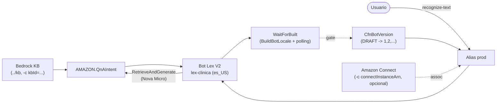

# Demo-Lex: Amazon Lex + Bedrock Knowledge Base (CDK)

> *Bot conversacional médico: intents, slots y QnAIntent sobre la Knowledge Base*

Proyecto de demostracion de Bot, el cual complementa `demo-kb` (incluso `demo-cx`): aplica lo que se hace en la
consola de Amazon Lex pero **con CDK (TypeScript)**, es decir:

- creación de bot
- definición de locale
- definición de intents
- definición de slots
- definición de slot types
- conexión de `AMAZON.QnAIntent` a la Knowledge Base de Bedrock

> usa **CDK** para compilar (`Build`), publicar (`version`) y exponer por **alias**.

```
  ______
./ lex /
├── cdk/bin/lex.ts              # App única: LexStack (región fija us-east-1)
├── cdk/lib/lex-stack.ts        # Bot + role + locale + intents + QnA + versión + alias
├── cdk/lib/wait-built.ts       # Custom resource "Build" (BuildBotLocale + polling)
├── cdk/test/lex.test.ts        # Synth tests (sin VPC, DESTROY, desacoplo KB)
├── cdk/cdk.json                # App + feature flags (CLI runs from here)
├── srv/wait-built/index.ts     # Handler del custom resource (lexv2-models)
├── scripts/smoke.mjs           # recognize-text contra el alias prod
└── README.md / HELP.md / DEPLOY.md
```

## Qué cubre (consola → CDK)

| Consola de Amazon Lex | CDK (`LexStack`) |
|-----------------------|------------------|
| Crear bot (nombre, rol IAM, *Idle session TTL*, *COPPA*) | `CfnBot` + `iam.Role` (trust `lex.amazonaws.com`) |
| Default language / locale | `botLocales` con `localeId: es_US`, voz Lupe, umbral NLU 0.40 |
| Slot types propios | `slotTypes` (`Especialidad` con valores y sinónimos) |
| Intents + sample utterances | `intents` (`AgendarCita`, `ConsultarCita`, `FallbackIntent`) |
| Slots y prompts de elicitación | `slots` con `valueElicitationSetting` (required + prompt) |
| *QnA intent* + conectar KB Bedrock | `parentIntentSignature: AMAZON.QnAIntent` + `qnAIntentConfiguration` → KB |
| Build | `autoBuildBotLocales` + custom resource `WaitForBuilt` |
| Publish (versión) | `CfnBotVersion` (source `DRAFT`) |
| Alias prod | `CfnBotAlias` (`prod` → versión publicada) |
| Conversation logs (texto) | `ConversationLogSettings` → CloudWatch Logs |
| Asociar bot a Connect *(+ opcional)* | `CfnIntegrationAssociation` (`LEX_BOT`) con `-c connectInstanceArn` |

## Arquitectura



> Flujo: el usuario habla con el **alias `prod`**; los intents clásicos
(`AgendarCita` con slots `Especialidad`/`Fecha`) se resuelven dentro del bot,
y el **QnAIntent** responde con `RetrieveAndGenerate` sobre la Knowledge
Base de Bedrock de `demo-kb` (modelo `amazon.nova-micro-v1:0`).

## Desacoplo (como demo-cx)

El stack **no crea** la KB: la recibe por contexto.

```bash
# Primero desplegar ../kb y copiar su KbId:
npm run deploy:lex:dev -- -c kbId=<KbId de demo-kb>
```

- `-c kbId=<id o arn>` — obligatorio; el QnAIntent necesita la fuente de
  conocimiento (Lex rechaza el bot sin ella). Sin `kbId`, synth falla con
  mensaje claro.
- `-c connectInstanceArn=arn:aws:connect:...` — opcional; asocia bot + alias
  a una instancia Connect existente (equivalente a consola Connect → Flows →
  Amazon Lex → añadir bot). Sin él el bot se despliega igual (texto).

## Usage

```bash
npm ci
npm run build      # tsc --noEmit
npm test           # jest synth
npm run synth -- -c kbId=<KbId>        # o sin kbId: falla claro
npm run deploy:lex:dev -- -c kbId=<KbId>
npm run smoke       # recognize-text contra el alias prod (sigue elicitación)
npm run destroy:lex:dev
```

## Requirements

Node >= 22, AWS CLI v2, `us-east-1` (Lex español `es_US` y Bedrock en la
misma región), KB de `demo-kb` desplegada e ingerida (`npm run ingest`).

## Verificación del despliegue

```bash
aws lexv2-models list-bots --region us-east-1
aws lexv2-models list-bot-aliases --bot-id <BotId> --region us-east-1
npm run smoke
```

El smoke envía `"quiero agendar una cita"` y completa el primer slot que el
bot pida (`Especialidad` → `cardiologia`), mostrando intent, dialogAction y
slots, igual que el `recognize-text` del CLI de `Amazon-Lex.md`.